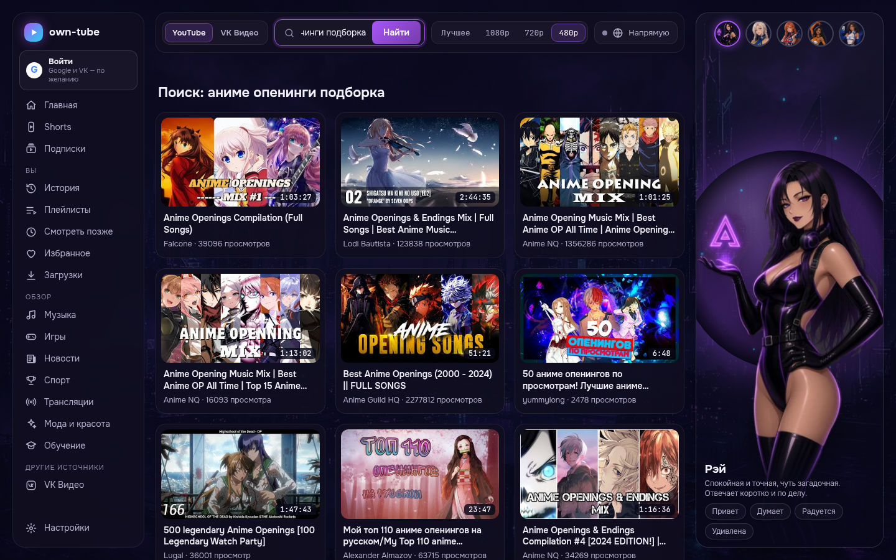
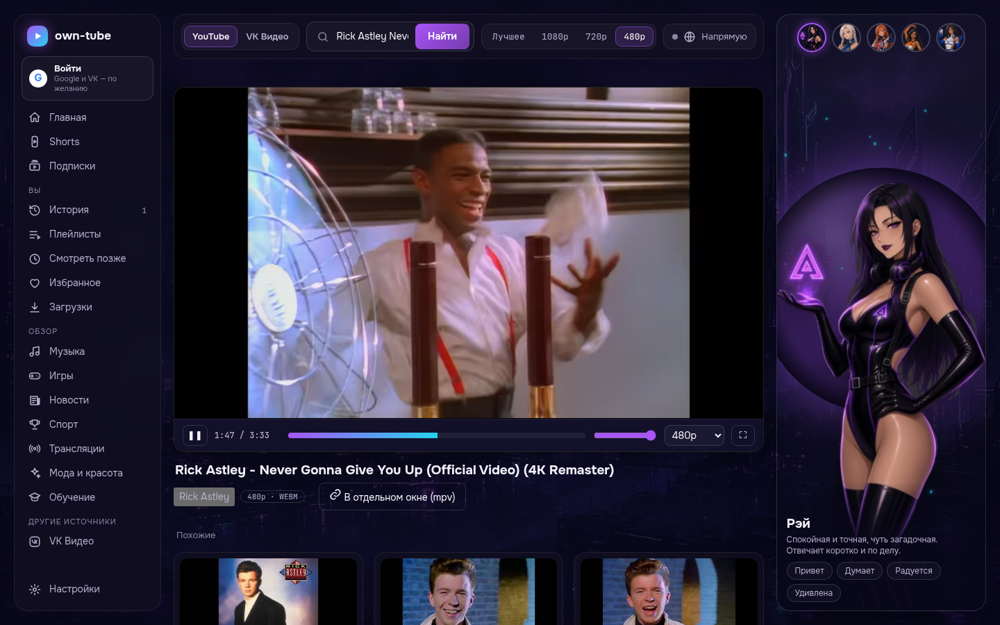
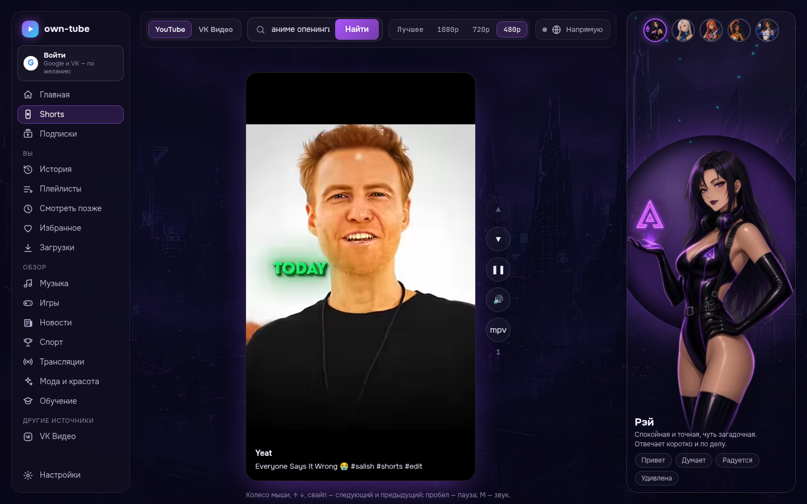
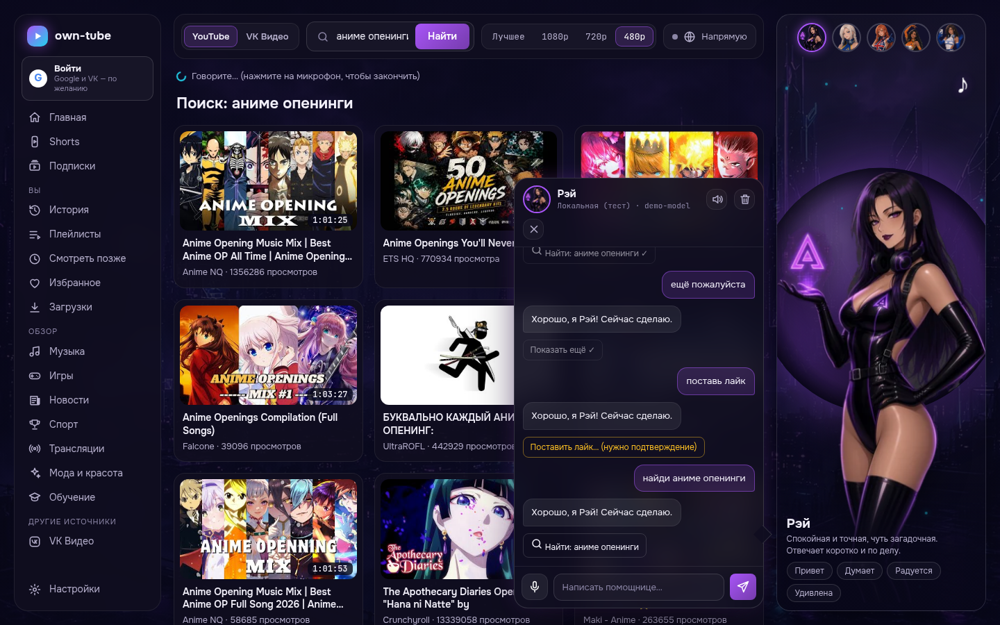
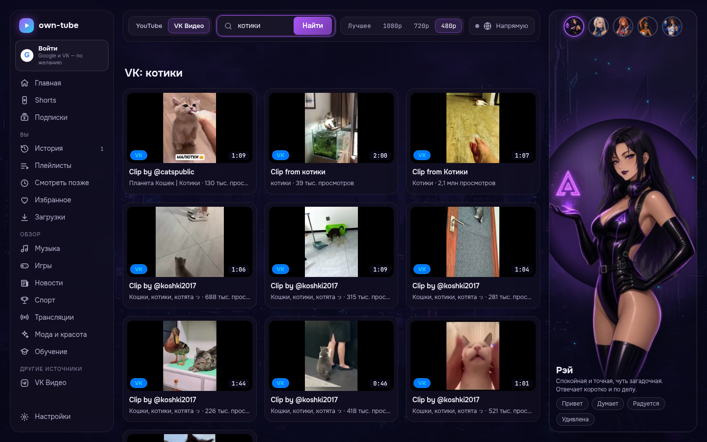
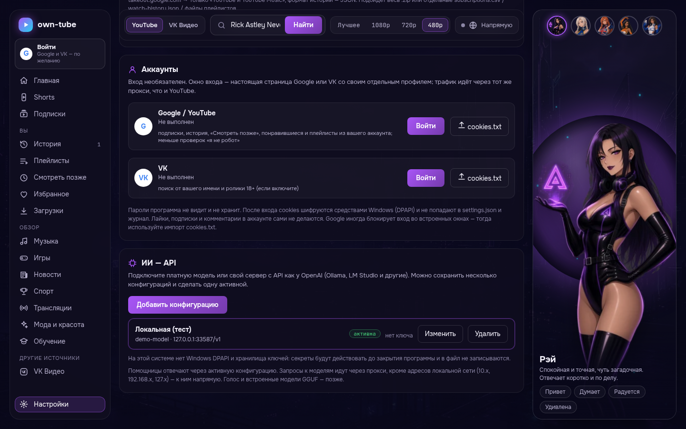
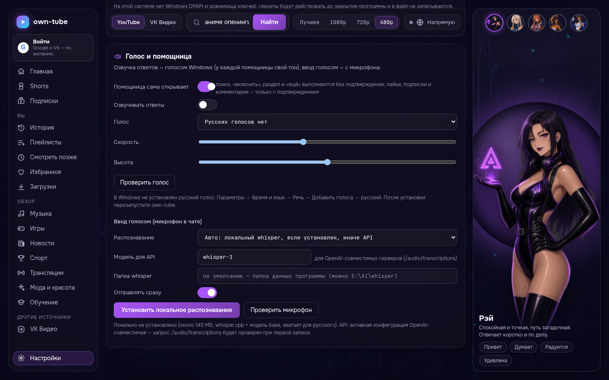
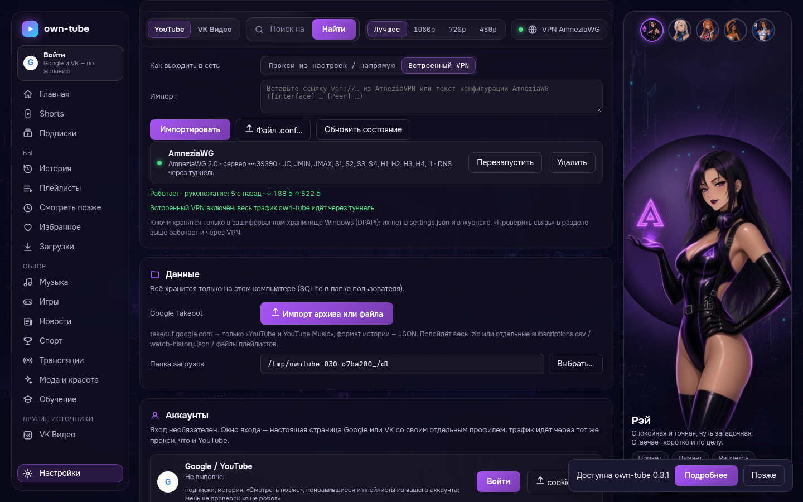
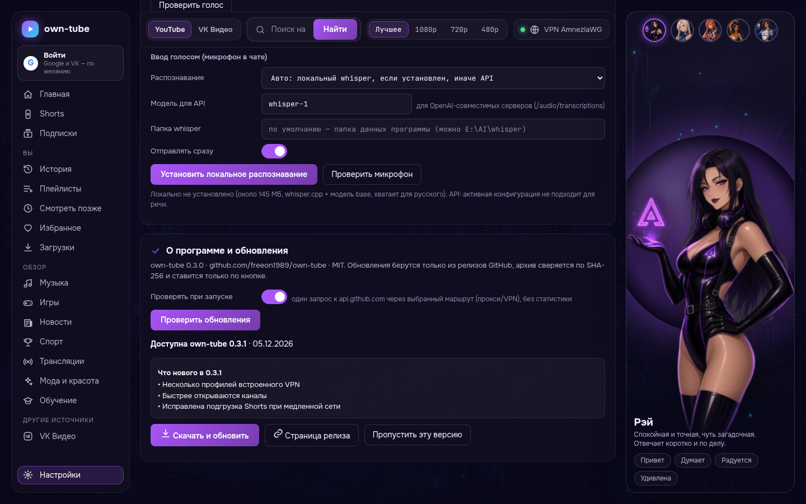

**[Русский](README.md)** · **[English](README.en.md)**

# own-tube

A desktop YouTube client for Windows. Author and owner of the code: [freeon1989](https://github.com/freeon1989). Written from scratch, with no code taken from other clients.

## Download

**[Download own-tube for Windows (x64)](https://github.com/freeon1989/own-tube/releases/latest/download/own-tube-win-x64.zip)**

[~170 MB, zip](https://github.com/freeon1989/own-tube/releases/latest/download/own-tube-win-x64.zip) · [releases page](https://github.com/freeon1989/own-tube/releases)

Current version: **0.3.3**. Requires **Windows 10 or 11 (x64)** and [Microsoft Edge WebView2](https://developer.microsoft.com/microsoft-edge/webview2/) (already present on Windows 11 and on most Windows 10 installs).

Unpack the archive and run `own-tube.exe`. Windows SmartScreen may show a warning: the build is not digitally signed. Click “More info” → “Run anyway”.

All data stays on this computer, in `%APPDATA%\own-tube`. There is no telemetry. Updates come from GitHub Releases and only after you click “Update” (Settings → About).

SHA-256 (the files `own-tube-win-x64.zip` and `own-tube-0.3.3-win-x64.zip` are identical):

```
f2f958b64b1535507b100dee010a6e5a9a0e87bcb4eb197eb7cdeb13713ea10a
```

## Screenshots

Search and the assistant:



Built-in player:



Shorts you can keep scrolling:



Chat with the assistant: search starts immediately, a like only after confirmation, voice and microphone:



VK Video search:



Google and VK sign-in, AI settings:



Assistant voice and speech recognition:



Built-in AmneziaWG VPN for own-tube only (screenshot with a test server):



Updates from GitHub Releases — only when you click the button:



## Features

- A YouTube-style sidebar: Home, Shorts, Subscriptions; History, Playlists, Watch later, Favourites, Downloads; Browse (Music, Gaming, News, Sports, Live, Fashion & Beauty, Learning); VK Video; Settings.
- **In-window player**: seek, quality, fullscreen, SponsorBlock, related videos. Optionally “In a separate window (mpv)”. Livestreams open in mpv.
- **Fast lists** from YouTube's internal API, first-page cache, load-on-scroll and a “Show more” button.
- **Shorts**: a vertical player (wheel, arrows, swipe) and an endless feed.
- **Assistants** (Rei, Yuki, Kate, Lila, Nina): chat through the active “AI — API” configuration (OpenAI-compatible servers, Anthropic Claude, Google Gemini). Search, playing a video and opening a section run immediately; likes, subscriptions, comments and deletions need confirmation.
- **Voice**: spoken replies and microphone input (via an API or local whisper.cpp).
- **Built-in AmneziaWG VPN** for this app only: the same `vpn://` link from AmneziaVPN or a `.conf` file, with no administrator rights and no separate client. AmneziaWG 1.0/1.5/2.0/3.1 and WireGuard, DNS through the tunnel, keys only in DPAPI.
- **Updates from GitHub**: a launch-time check (can be turned off), a changelog, install by button with a SHA-256 check, a backup of the previous version and rollback.
- **SOCKS5/HTTP proxy** for all app traffic (the password is stored with Windows DPAPI). “Check connection” shows each step, including the start of a real video download.
- **Google and VK sign-in** in a separate window with the real sign-in page. The program never sees the password; cookies are encrypted on disk. A fallback path is importing `cookies.txt`.
- **VK Video**: search without signing in; 18+ content only after sign-in and a toggle.
- Several appearance themes, including “match the assistant”.
- Downloads via yt-dlp and ffmpeg, Google Takeout import. Everything is stored locally in SQLite.

## What's new in 0.3.3

- **Faster video loading.** The stream is read through the app's local server: parallel chunks (up to 6 connections) with prefetch and `&range=` for googlevideo, instead of one long request that YouTube slows down. Less buffering, and faster start and seeking.
- **Quick start**: 480p first (configurable), then a seamless switch to the chosen quality; a video is prepared on hover. Settings → Playback: “Quick start”, start quality, “Prefetch”. The player shows a buffered bar. “Check connection” reports “Video speed”.
- **Back button** (video page, Shorts), Alt+←, Backspace and the mouse back button: return to the same list and scroll position without new requests.
- **Account feeds.** Google: Home, Subscriptions, History, Watch later, Liked, and account playlists with infinite load. VK: recommendations, subscriptions, My videos. If the session is stale, a “Sign in again” hint is shown.

Earlier notes for 0.3.2, 0.3.1, 0.3.0 and 0.2.3 are in the [Russian README](README.md).

## What is not, and will not be, included

No telemetry, and no updates installed without your click. Network use: YouTube (search, thumbnails, streams), SponsorBlock (if enabled), VK (if you use that tab), the selected AI model server, Google/VK sign-in pages (if you click Sign in), your AmneziaWG server (if the built-in VPN is on), `api.github.com` — one request at launch for the version check (can be disabled) and github.com when downloading an update.

## Security

- Processes are started with an argument list, not a shell. The stream URL is passed after `--`.
- Video and channel IDs, links, queries, proxies and stream URLs are validated (`owntube/validate.py`); streams are HTTPS only, from the expected source hosts.
- SQL uses parameters only. The UI does not use `innerHTML`; a strict CSP is in place.
- The settings file contains no secrets; a login and password in the proxy URL are rejected.
- The proxy password, API keys and account cookies live only in encrypted `secrets.dpapi` (DPAPI of the current Windows user) and are not written to the log.
- The local media server listens only on 127.0.0.1; URLs contain a random token.
- The sign-in window allows only listed Google/VK domains through the bridge.
- Updates: HTTPS only and only GitHub hosts (including redirects), SHA-256 is checked before unpacking, archive paths are validated, install happens only after you click.
- Built-in VPN: SOCKS5 only on 127.0.0.1, a random port and password on each launch; the config is passed to the helper on stdin and stored on disk only in DPAPI.

## Building for Windows

```
scripts/build_windows.sh     # Wine + Python 3.12 + PyInstaller, onedir
```

The script fetches mpv, ffmpeg and deno from pinned URLs and checks SHA-256 (`scripts/fetch_tools.py`), builds `awgproxy.exe` from `helper/awgproxy` (`scripts/build_awg_helper.sh`), puts everything in `tools\` next to the exe, runs `own-tube.exe --selftest` under Wine, and packs `own-tube-<version>-win-x64.zip` and `own-tube-win-x64.zip` with `.sha256` files. What each release must contain is in [scripts/README.md](scripts/README.md).

## Running from source

```
python -m venv .venv && .venv/bin/pip install -r requirements.txt     # on Windows: .venv\Scripts\pip
python -m owntube
```

You need mpv, ffmpeg (for downloads) and deno (the JavaScript engine for yt-dlp): in the `tools/` folder next to the program, or on PATH; the mpv path can also be set in Settings.
Self-test without a window: `python -m owntube --selftest report.json`.

## Development

```
pip install -r requirements-dev.txt
pytest
python scripts/shoot.py     # screenshots screenshots/stage1_*.png (real search, no window)
```

## What's next

- Live heroine animation.
- YouTube account actions from chat (like, subscribe, comment — with confirmation).
- Several VPN profiles and a server picker.

## How the built-in VPN works

All route selection is in `owntube/network.py`; `AwgProvider` (`owntube/awg.py`) implements the same `current()`/`check()` as the proxy. The program starts `tools\awgproxy.exe`, passes the configuration on stdin and receives a local SOCKS5 address — then the existing network code (lists, thumbnails, video, yt-dlp, mpv through the bridge) works unchanged. The helper exits with the program. Server addresses and keys are not in the repository; tests use their own test server.

## Full UI mockup

`owntube/ui/mockup.html` is a static interactive mockup of the planned interface (YouTube-style menu, assistants with chat, AI settings, VPN). The data is sample data; nothing actually works. Screenshots: `python scripts/shoot_mockup.py` → `screenshots/mockup_*.png`.

## Licence

MIT © freeon1989, see [LICENSE](LICENSE). The Onest and JetBrains Mono fonts are SIL OFL 1.1.
