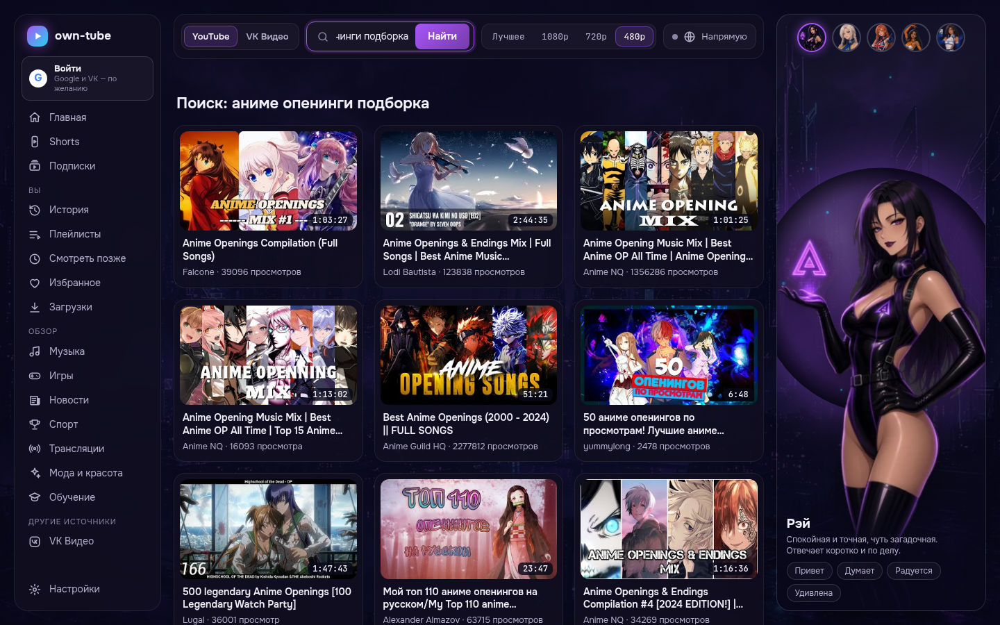
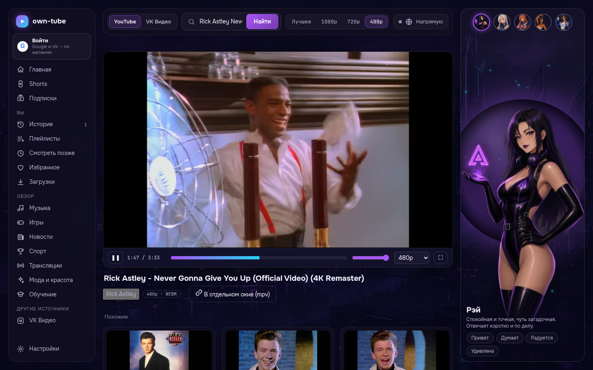
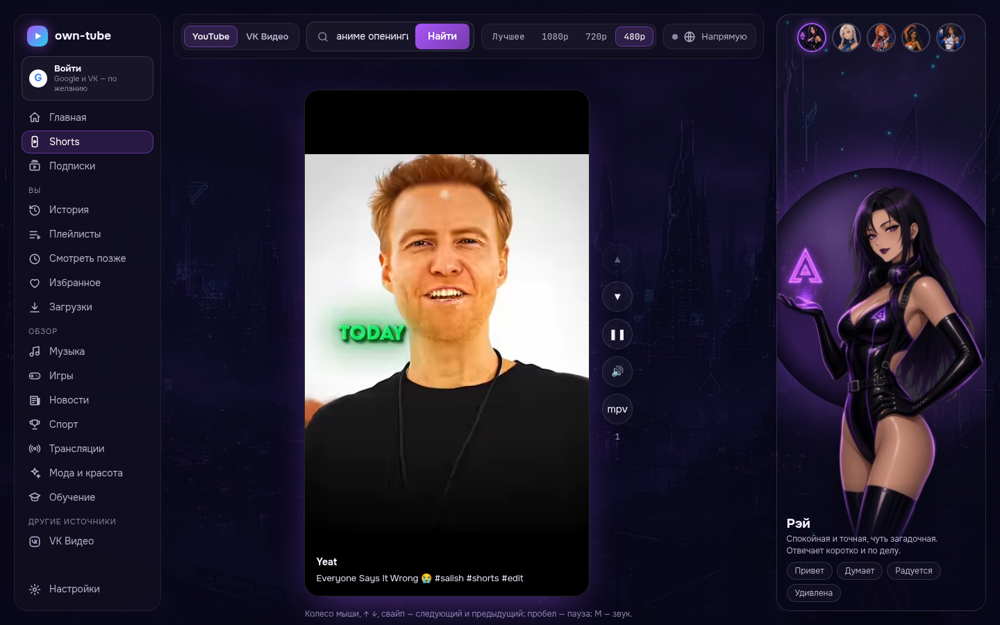
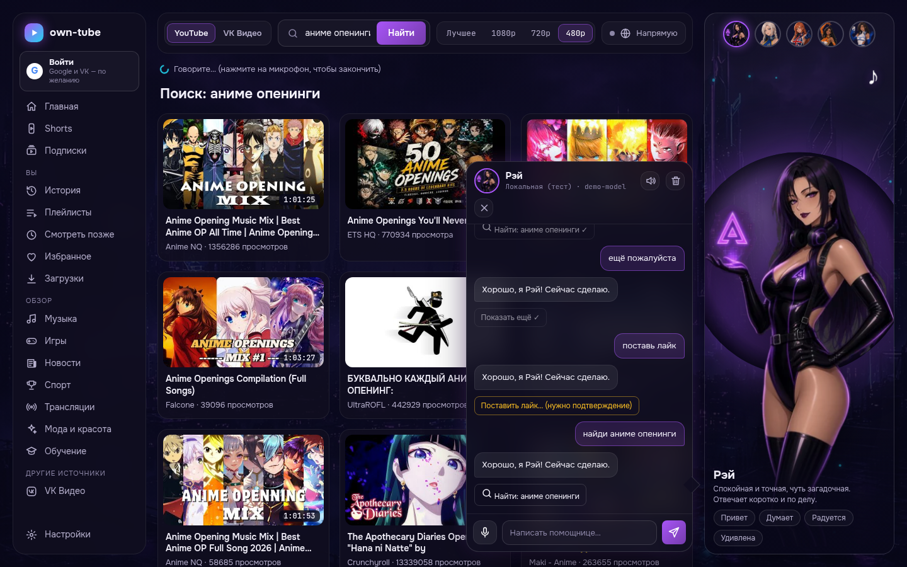
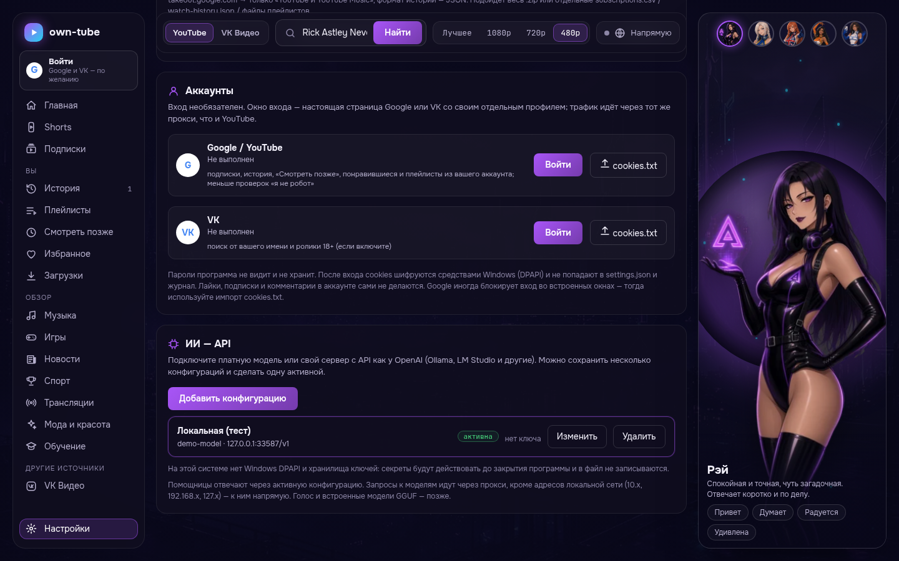
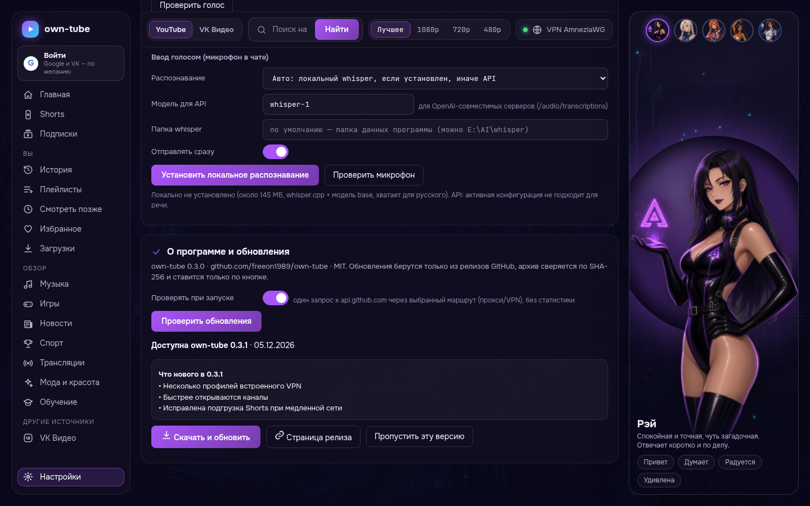

# own-tube

Свой настольный клиент YouTube для Windows. Автор и владелец кода: [freeon1989](https://github.com/freeon1989). Написан с нуля, без заимствований из других клиентов.

*A desktop YouTube client for Windows, written from scratch by freeon1989.*

## Скачать

**[Скачать own-tube для Windows (x64)](https://github.com/freeon1989/own-tube/releases/latest/download/own-tube-win-x64.zip)**

[~170 МБ, zip](https://github.com/freeon1989/own-tube/releases/latest/download/own-tube-win-x64.zip) · [страница релизов](https://github.com/freeon1989/own-tube/releases)

Текущая версия: **0.3.2**. Нужны **Windows 10 или 11 (x64)** и [Microsoft Edge WebView2](https://developer.microsoft.com/microsoft-edge/webview2/) (в Windows 11 и в большинстве установок Windows 10 он уже есть).

Распакуйте архив и запустите `own-tube.exe`. Windows SmartScreen может показать предупреждение: сборка не подписана цифровым сертификатом. Нажмите «Подробнее» → «Выполнить в любом случае».

Все данные остаются на этом компьютере, в папке `%APPDATA%\own-tube`. Телеметрии нет. Обновление — из релизов GitHub и только по кнопке «Обновить» (Настройки → О программе).

SHA-256 (файлы `own-tube-win-x64.zip` и `own-tube-0.3.2-win-x64.zip` совпадают):

```
59cf8c38f19d1ab6634544e1e002c8c8f84f1321ed0d02abb9e27e4dc436996a
```

## Скриншоты

Поиск и помощница:



Встроенный плеер:



Shorts, которые можно листать дальше:



Чат с помощницей: поиск запускается сразу, лайк — только после подтверждения, голос и микрофон:



Поиск по VK Видео:


Вход в Google и VK, настройки ИИ:



Голос помощницы и распознавание речи:


Встроенный VPN AmneziaWG только для own-tube (снимок с тестовым сервером):


Обновление из релизов GitHub — только по кнопке:



## Возможности

- Боковое меню как у YouTube: Главная, Shorts, Подписки; История, Плейлисты, Смотреть позже, Избранное, Загрузки; Обзор (Музыка, Игры, Новости, Спорт, Трансляции, Мода и красота, Обучение); VK Видео; Настройки.
- **Плеер в окне программы**: перемотка, качество, полный экран, SponsorBlock, похожие ролики. По желанию — «В отдельном окне (mpv)». Прямые эфиры открываются в mpv.
- **Быстрые списки** из внутреннего API YouTube, кэш первых страниц, подгрузка при прокрутке и кнопка «Показать ещё».
- **Shorts**: вертикальный плеер (колесо, стрелки, свайп), бесконечная лента.
- **Помощницы** (Рэй, Юки, Кейт, Лила, Нина): чат через активную конфигурацию «ИИ — API» (OpenAI-совместимые серверы, Anthropic Claude, Google Gemini). Поиск, запуск видео и переход в раздел выполняются сразу; лайки, подписки, комментарии и удаление — только с подтверждением.
- **Голос**: озвучка ответов и ввод с микрофона (через API или локальный whisper.cpp).
- **Встроенный VPN AmneziaWG** только для этого приложения: та же ссылка `vpn://` из AmneziaVPN или файл `.conf`, без прав администратора и без отдельного клиента. AmneziaWG 1.0/1.5/2.0/3.1 и WireGuard, DNS через туннель, ключи только в DPAPI.
- **Обновление из GitHub**: проверка при запуске (отключается), список изменений, установка по кнопке с проверкой SHA-256, резервная копия прежней версии и откат.
- **Прокси SOCKS5/HTTP** для всего трафика приложения (пароль хранится через Windows DPAPI). Кнопка «Проверить связь» показывает каждый шаг, в том числе начало загрузки настоящего видео.
- **Вход в Google и VK** в отдельном окне с настоящей страницей входа. Пароль программа не видит, cookies шифруются на диске. Запасной путь — импорт `cookies.txt`.
- **VK Видео**: поиск без входа; 18+ — только после входа и по переключателю.
- Несколько тем оформления, в том числе «как у помощницы».
- Загрузки через yt-dlp и ffmpeg, импорт Google Takeout. Всё хранится локально в SQLite.

## Что нового в 0.3.2

- **AmneziaWG 3.1** во встроенном VPN: импорт `.conf` и `vpn://` принимает диапазоны (`PersistentKeepalive = 25-35`, `RekeyAfterTime`, `RekeyTimeout`, `RejectAfterTime`, `KeepaliveTimeout`, `MaxHandshakeAttempts`), `HeaderProtectionKey`, `RandomTrailers`, `DisableCookies`, `ContentPaddingAddition`, H1–H4 числом или диапазоном. Параметры передаются в amneziawg-go v3.1 как есть; неизвестный параметр — ошибка, а не тихий пропуск. Проверено рукопожатием с тестовым сервером 3.1.
- Поле импорта скрыто и очищается после успешного импорта.

## Что было в 0.3.1

- Исправлен запуск на Windows после распаковки zip из браузера (ошибка pythonnet «Failed to resolve Python.Runtime.Loader.Initialize»): рядом с exe теперь `own-tube.exe.config`, при старте с файлов в папке программы снимается пометка «из интернета» (`owntube/motw.py`, только внутри папки), при сбое — понятное сообщение. Версии pywebview, pythonnet и clr_loader закреплены в `requirements.txt`. Если не помогло: `Get-ChildItem -Recurse "папка\own-tube" | Unblock-File` в PowerShell.

## Что было в 0.3.0

- **Встроенный VPN AmneziaWG** (Настройки → VPN). Туннель работает внутри программы через `tools\awgproxy.exe` (amneziawg-go + сетевой стек gVisor в пользовательском режиме): системный адаптер и права администратора не нужны, остальные программы идут как обычно. Программа говорит с ним по локальному SOCKS5 на 127.0.0.1 со случайным портом и одноразовым паролем. Поддерживаются Jc/Jmin/Jmax, S1–S4, H1–H4, I1–I5. Импорт ссылки `vpn://` (как в AmneziaVPN) или `.conf`; конфигурация хранится только зашифрованной (DPAPI). Статус: рукопожатие, трафик, задержка. «Проверить связь» работает и через VPN.
- **Обновление из релизов GitHub** (Настройки → О программе): один запрос к `api.github.com` при запуске (можно выключить), описание изменений, «Обновить» скачивает `own-tube-win-x64.zip`, сверяет SHA-256 с файлом `.sha256` того же релиза, заменяет папку программы и перезапускает её. Прежняя версия остаётся рядом (`own-tube.old-<версия>`), данные в `%APPDATA%` не трогаются. «Пропустить эту версию».

## Что было в 0.2.3

- Скорость: списки одним запросом, постоянные соединения, кэш, прогрев при запуске, подготовка потока при наведении.
- «Показать ещё» и бесконечная прокрутка, в том числе для VK.
- Shorts с пролистыванием и подготовкой следующего ролика.
- Прокси: соединение по имени хоста, повторы, запасной путь по IPv4, лимит одновременных соединений, повторная выдача адреса потока при сбое.
- Cookies VK/Google читаются из профиля окна входа целиком.
- Помощница сама выполняет безопасные действия (поиск, включить, раздел, ещё).
- Голос: озвучка и микрофон.

## Чего нет и не будет

Телеметрии и установки обновлений без вашего нажатия. Сеть: YouTube (поиск, обложки, потоки), SponsorBlock (если включён), VK (если пользоваться вкладкой), выбранный сервер модели ИИ, страницы входа Google/VK (если нажать «Войти»), ваш сервер AmneziaWG (если включён встроенный VPN), `api.github.com` — один запрос при запуске для проверки версии (отключается) и github.com при скачивании обновления.

## Безопасность

- Процессы запускаются списком аргументов, без shell. Адрес потока передаётся после `--`.
- ID видео и каналов, ссылки, запросы, прокси и адреса потоков проверяются (`owntube/validate.py`); потоки только по https с хостов нужного источника.
- SQL только с параметрами. Интерфейс не использует `innerHTML`; строгий CSP.
- В файле настроек нет секретов; логин и пароль в адресе прокси не принимаются.
- Пароль прокси, ключи API и cookies аккаунтов — только в зашифрованном `secrets.dpapi` (DPAPI текущего пользователя Windows); в журнал не пишутся.
- Локальный медиасервер слушает только 127.0.0.1, адреса содержат случайный токен.
- Окно входа пускает через мост только домены Google/VK из списка.
- Обновления: только https и только хосты GitHub (в том числе при переадресации), SHA-256 сверяется до распаковки, пути в архиве проверяются, установка — только по кнопке.
- Встроенный VPN: SOCKS5 только на 127.0.0.1, случайный порт и пароль на каждый запуск; конфигурация передаётся помощнику через stdin, на диске — только в DPAPI.

## Сборка для Windows

```
scripts/build_windows.sh     # Wine + Python 3.12 + PyInstaller, onedir
```

Скрипт качает mpv, ffmpeg и deno по закреплённым адресам и сверяет SHA-256 (`scripts/fetch_tools.py`), собирает `awgproxy.exe` из `helper/awgproxy` (`scripts/build_awg_helper.sh`: Go 1.27.3, amneziawg-go v3.1.20261116, побайтово воспроизводимо), кладёт всё в `tools\` рядом с exe, запускает `own-tube.exe --selftest` под Wine и собирает `own-tube-<версия>-win-x64.zip` и `own-tube-win-x64.zip` с файлами `.sha256`. Что должно быть в каждом релизе — [scripts/README.md](scripts/README.md).

## Запуск из исходников

```
python -m venv .venv && .venv/bin/pip install -r requirements.txt     # на Windows: .venv\Scripts\pip
python -m owntube
```

Нужны mpv, ffmpeg (для загрузок) и deno (JavaScript-движок для yt-dlp): в папке `tools/` рядом с программой или в PATH; путь к mpv можно указать в настройках.
Самопроверка без окна: `python -m owntube --selftest report.json`.

## Разработка

```
pip install -r requirements-dev.txt
pytest
python scripts/shoot.py     # скриншоты screenshots/stage1_*.png (реальный поиск, без окна)
python scripts/shoot_023.py [--socks]   # 0.2.3 в Chromium
python scripts/shoot_022.py [--socks]   # 0.2.2 в Chromium
```

Перед каждым push: `scripts/scan_secrets.sh` должен напечатать `SCAN OK`.

## Структура

```
owntube/
  app.py        окно pywebview
  api.py        методы для интерфейса (всегда возвращают {ok, ...})
  search.py     запасной путь через yt-dlp: поиск, категории, Shorts, лента подписок
  innertube.py  быстрые списки YouTube (поиск, канал, Shorts) с токеном продолжения
  lists.py      страницы, курсоры «ещё», кэш первых страниц
  voice.py      распознавание речи: API, whisper.cpp, установка
  vk.py         VK Видео: ссылка и поиск
  player.py     адреса потоков, команда ffmpeg для встроенного плеера, запуск mpv
  media.py      локальный медиасервер: обложки и видео через прокси
  httpc.py      HTTP(S)-клиент поверх маршрута (частные адреса напрямую)
  diagnostics.py  «Проверить связь» по шагам
  accounts.py   вход Google/VK: cookies, Netscape, DPAPI
  login_window.py  окно входа (own-tube --login google|vk)
  ai/           конфигурации, провайдеры (OpenAI/Claude/Gemini), помощницы
  downloads.py  очередь загрузок
  db.py         SQLite
  takeout.py    импорт Google Takeout
  sponsorblock.py
  network.py    маршрут трафика (Route, RouteProvider, ManualProxy): единственное место про прокси
  awg.py        встроенный VPN: разбор vpn:// и .conf, запуск awgproxy, AwgProvider, выбор маршрута
  motw.py       снятие пометки «из интернета» с файлов программы, понятная ошибка pythonnet
  updater.py    обновление из релизов GitHub: проверка, скачивание с SHA-256, замена папки
  bridge.py     мост HTTP CONNECT → SOCKS5 для mpv
  ytdl.py       общие настройки yt-dlp и запросы через его сеть
  tools.py      поиск mpv/ffmpeg/deno
  settings.py   настройки (JSON в папке пользователя)
  validate.py   проверки
  selftest.py   самопроверка сборки
  mpv/          Lua-скрипт пропуска сегментов
  ui/           index.html, style.css, app.js, assets/
helper/awgproxy/  Go: AmneziaWG + gVisor netstack + SOCKS5 на 127.0.0.1 (tools\awgproxy.exe)
tests/          pytest
scripts/        shoot.py, build_windows.sh, build_awg_helper.sh, fetch_tools.py, scan_secrets.sh,
                awg_test_stand.py и bench_awg_vs_socks.py (тестовый сервер AWG и замер скорости)
docs/START.txt  памятка, кладётся в zip
docs/screenshots/  снимки интерфейса для этой страницы
```

## Дальше

- Живая анимация героинь.
- Действия с аккаунтом YouTube из чата (лайк, подписка, комментарий — с подтверждением).
- Несколько профилей VPN и выбор сервера.

## Как устроен встроенный VPN

Весь выбор маршрута — в `owntube/network.py`; `AwgProvider` (`owntube/awg.py`) реализует тот же `current()`/`check()`, что и прокси. Программа запускает `tools\awgproxy.exe`, передаёт ему конфигурацию через stdin и получает адрес локального SOCKS5 — дальше весь существующий сетевой код (списки, обложки, видео, yt-dlp, mpv через мост) работает без изменений. Помощник завершается вместе с программой. Адресов серверов и ключей в репозитории нет; тесты используют собственный тестовый сервер.

## Макет полного интерфейса

`owntube/ui/mockup.html` — статический интерактивный макет планируемого интерфейса (меню как у YouTube, помощницы с чатом, настройки ИИ, VPN). Данные примерные, ничего не работает по-настоящему. Скриншоты: `python scripts/shoot_mockup.py` → `screenshots/mockup_*.png`.

## Лицензия

MIT © freeon1989, см. [LICENSE](LICENSE). Шрифты Onest и JetBrains Mono — SIL OFL 1.1.
